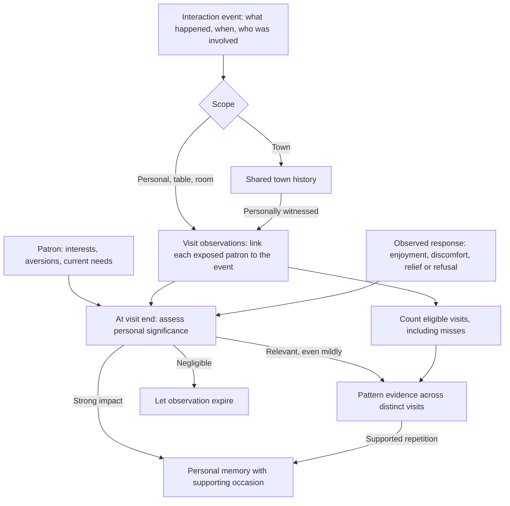

# Travelling Inn — design journal
24 November 2026

## TL;DR

The inn is about getting to know people well enough to care for them, and giving them room to care for the keeper in return. Mood shapes how a gesture lands today. Personality and circumstance help decide whether it stays with a patron. Hedda might remember an unasked-for cup of tea because she arrived shivering; after several such visits, she might simply come to expect that the keeper notices when she’s cold.

The proposed system keeps selected memories. An event can reach one guest, a table, a room or the whole town. Repetition can turn a moment into a habit, a shared story or an expectation. The keeper’s own mood colors familiar work and shapes the morning hand of taproom cards. The main open questions are how memories strengthen or fade, when patrons bring them up, and when an encounter should pause service for a dialogue.

## Contents

- [Why mood belongs in this game](#why-mood-belongs-in-this-game)
- [From tags to something a patron notices](#from-tags-to-something-a-patron-notices)
- [Hedda and Offer Unasked](#hedda-and-offer-unasked)
- [What sticks, and for whom?](#what-sticks-and-for-whom)
- [“Remember that stew?”](#remember-that-stew)
- [The keeper’s weather and the morning hand](#the-keepers-weather-and-the-morning-hand)
- [When the inn cares for the keeper](#when-the-inn-cares-for-the-keeper)
- [Still open for mood](#still-open-for-mood) · [On the board](#on-the-board)
- [Working notes and system sketch](#working-notes-and-system-sketch) · [Jump to the memory diagram](#proposed-memory-system)

## Why mood belongs in this game

We started with tags on a bowl of stew and ended with a regular asking the keeper to sit down for a cup. The question connecting those moments was why the player would come to care about a particular person in the inn.

The keeper has limited time. Spending a moment with one person means giving them a piece of the evening. For that choice to carry weight, the guest needs to notice it in their own way. Mood gives the keeper a reason to pay attention today, even to someone they have known for years. Memory lets an evening matter after it ends. Over time, a patron can come to know the keeper well enough to offer some care in return.

## From tags to something a patron notices

The prototype already gives stew the qualities *warm* and *hearty*. A patron can like those qualities, and eating the stew can also meet a physical need. That distinction travels beyond food. A soaked guest might seek the fireplace; a guest following a game of darts might barely notice a tune another patron loves.

The design direction was to let the same event reach several people while leaving each free to experience it differently. An offer reaches its recipient. An argument can reach a table. A performance can reach a room. Someone who heard an argument can remember the row; only someone who saw the cheating has grounds to remember who cheated.

Sometimes the opportunity to notice comes from the patron. Walking in or leaving gives them a reason to register the cleanliness of the tavern. Stepping into earshot gives them a chance to notice the gramophone. We discussed staggering ambient checks and retaining the result briefly, so crossing the edge of earshot twice needn’t give the tune two chances to command attention. The interval remains a playtest question. Nor does every observation need to become commentary; the keeper needs room to hear a remark when one matters.

## Hedda and Offer Unasked

We chose one patron and one card as the entry point into memory. Hedda, the miller’s widow, is described in the prototype as saying little. She loves rain and grey weather, dislikes storms, and enjoys homely drinks. Her reserve tells us little about whether she welcomes unsolicited help. That part of her character remains open.

Suppose Hedda comes in shivering. The keeper plays *Offer Unasked* and brings hot tea. The action establishes who offered what. Hedda supplies the circumstances and the outcome: whether she wanted it, whether she drank it, whether it warmed her, and how the gesture landed. If she declined, the memory can contain the offer and the refusal. It cannot contain the taste of tea she never drank.

The same encounter could leave Hedda grateful for the warmth and embarrassed at being singled out. Those reactions can coexist. A single positive-or-negative score would lose part of what happened. She could even leave as sad as she arrived and still remember the kindness.

## What sticks, and for whom?

We settled on a selective memory log. The purpose is to retain occasions that meant something to this patron, with enough truthful detail to support later behavior or conversation. We explored five candidate personality dimensions: preferred company, tolerance for bustle, autonomy, novelty and privacy. Disgust sensitivity is a further candidate to test against things like a dirty floor or missing sundries. These dimensions are proposals, not assigned values for Hedda.

One way to test their independence is to change just one detail. Leaving the teapot within reach gives Hedda a choice. Refilling her cup without asking may land differently even if the tea and the warmth are identical. Or picture a patron who enjoys doubles at darts until the whole room falls silent to watch. Privacy could explain that hesitation even in a perfectly quiet room.

For a first feasibility test, an encounter would supply a small set of perceptible qualities. The patron’s concerns, current needs and actual experience would determine what stands out. This could run when something happens, without every actor continually checking every object. The difficult part is representing enough of the encounter to explain a reaction. A record that says only “tea served” cannot tell us whether the guest had a choice. We explored scoring sketches, but did not settle weights, thresholds or a finished algorithm.

## “Remember that stew?”

The first exceptional bowl might stand out on Monday. By Friday a regular comes back expecting it. When the dish disappears from the menu, what survives may be a stretch of time: “Remember that week he kept making that stew?” A later serving can extend a memory even when it no longer merits a separate anecdote.

Repetition also raised a distinction between what a patron can recall and what they have learned to expect. Hedda might forget which evening the keeper first set down a mug for her, yet still put her hand on the bar where it usually lands. A habit or an inside joke could emerge from those evenings. We parked the detailed rules for intensifying, fading and forgetting. Choosing when a patron speaks about a memory is another open mechanism. We want a well-earned remark to feel special and remain grounded in something the patron could actually know.

Personal recollection can sit alongside town knowledge. Serving the first house beer is a good example: the recipient can remember having the first mug, while the whole town gains a true subject of conversation. A public pattern can emerge more slowly, as when regulars learn that the menu changes every week. They can agree on that fact while disagreeing about whether they miss the pie.

## The keeper’s weather and the morning hand

A person’s emotional climate is their long baseline. Their mood is the weather moving through it. Someone inclined toward sorrow can have a genuinely joyful afternoon. Actual weather, crowding, warmth, furnishings, service, music, meals and other people can all shape the visit. We discussed socially influential patrons whose change of mood could carry to people nearby, with room for each listener to respond differently.

The keeper poses a different design question because the player needs agency. Wistfulness, homesickness, sadness and joy all belong in this inn. A mood can shift what the keeper brings to a pie or a brew. A familiar recipe can turn out differently in a way a regular comes to cherish. The player can keep a satisfying routine without being penalized for an emotional color.

Taproom cards make “the hand you were dealt” literal. Morning mood shapes the available hand; the player chooses a few thoughts or gestures to carry into the day. Perhaps today they have the words to recall a past summer or the presence of mind to offer a towel. An afternoon lull might give them time to read, sit with a drink or join a patron at darts. Whether that restores a spent use or offers a fresh draw is still open. One represents finding capacity again; the other represents a thought that only occurred because of how the afternoon unfolded.

## When the inn cares for the keeper

Patrons need room to initiate. After several busy evenings, the flow of arrivals might ease while a familiar regular stays a little longer. They pour a second cup. For once the keeper has time to accept. That pacing idea gives the player an opportunity and leaves the decision in their hands.

The last idea we named was a **dialogue**: a triggered encounter could pause ordinary service and let play become a back-and-forth conversation. We left open which encounters deserve that pause. Sometimes a regular setting down the second cup may already say enough.

## Still open for mood

This session went mostly into memory. These are the questions from Spec 3 (Mood and Season, Nov 8) and later sessions it didn't reach, plus where this journal and the older docs don't line up yet.

### Climate or season?
This journal calls the long baseline "emotional climate". Spec 3 and the naming rule call it the *season* (and spring, summer and so on are always *calendar seasons*). Pick one: rename it here, or let "climate" replace "season" everywhere.

### Mood itself is still undesigned
Spec 3's core hasn't been revisited: needs (hunger and thirst are now separate, with warmth; Spec 3 also had company and comfort), mood as a value pulled back toward the baseline, and which moments move it. The working notes suggest one mood value plus what last moved it as a first playtest; not settled.

### Contagion
Spec 3's dominant guests, whose mood carries to the table, get one mention here. What triggers a spread, how far it reaches and how strong it is are still open.

### Keeper moods: named states or free shifts?
Spec 3 proposed wistful, buoyant and flustered, each with a deck and a trace tag. This journal leans toward moods that shift in any direction, sideways too. That may answer Spec 3's "named states or a blend", but it isn't decided. Also open: is the keeper's long baseline a chosen backstory or does it emerge from play?

### Traits next to tastes and schemas
The candidate personality dimensions (company, bustle, autonomy, novelty, privacy, maybe disgust) sit beside Spec 2's tastes and the prototype's schemas (Hedda is Reserved). How they relate isn't stated: does a schema imply traits, or are they independent?

## On the board

Kanzo tasks that touch mood, as of Nov 24.

### #101 Epic: Mood
Nothing of mood is built. To build on: hunger, thirst and warmth as real values, logs of patrons going without, weather tastes (talk only), and the placeholder face slot on the status card (#29).

### Where mood shows: #76 overlay, #90 Innsight
The held-button view of the room. Both list guest mood faces and room feel as "later". #106 is Innsight's performance bug.

### What mood drives: #102 Taproom card game
The keeper's morning mood shapes the hand. The card game has no design yet, so the two get designed together, or mood first.

### What feeds mood: #35 music, #103 activities, #100 weather
Songs with tags, darts, board games, pipes, storytelling, weather through the calendar seasons. Room feel and reputation (#45, #69) want a spec of their own and overlap with comfort and company.

### Where mood comes out: #55 walkouts, #92 Delights too easy
A sour mood needs somewhere to go; walkouts are a candidate, within "nothing punishes". Delights land 46–56% of serves; mood changing how a guest takes an experiment could be part of the fix (#92 waits on #90).

### Others with a mood question
#56 staff (moods of their own?) and #40 day one prologue (the keeper's starting baseline, if it's a backstory).

---

## Working notes and system sketch

The notes below preserve the alternative mechanisms, prototype examples and open questions explored during the session.

## Scope
This is a record of the conversation. Kanzo and the local prototype were identified as the project references. From this point, use the conversation alone. Keep additions in this journal. The design ideas below are exploratory.

## Descriptive and qualifying tags
The designer wants objects and experiences across the inn to describe qualities that other actors can notice and respond to. Food is one example among many. A fireplace and music can also have qualities that matter to guests. Which qualities matter depends on the actor and situation.

Stew came up because the prototype gives it warm and hearty tags and a separate warmth effect. A soaked guest has a practical reason to seek warmth regardless of their taste for hearty food. A lively tune could please someone seeking company and bother someone seeking quiet.

## Mood and feasibility
The designer is interested in mood shaping an experience and the experience shaping mood. The concern is how to bound that interplay when guests, patrons, tables, snacks, dishes, music, lighting, sundries and the fireplace could all contribute.

One proposal was to let guests take stock at a few recognizable moments: settling into a seat, finishing food or drink, or having a meaningful interaction. Music, light and crowd could contribute to one room impression. A shared joke could affect both participants once. Physical needs could still guide behavior directly, as with a soaked guest seeking the fire.

One mood value and a record of what last moved it were suggested as a first playtest. Neither that representation nor the three example moments were settled. An open question is which moments give the player enough evidence to understand why a guest's mood changed.

## Weather
Weather was raised as a possible next topic. Rain and soaked arrivals illustrated the connection between environmental conditions and a guest's needs. The broader weather design is still open.

## What happens on the next tick?
The designer asked specifically about the cost of every actor checking every tagged source every tick. A proposed approach is to store room conditions once and let guests consult them at relevant moments. Sitting near a lit fire while wet could schedule a drying time. Leaving or losing the fire would interrupt that timer. A new tune could update the room once, with immediate reactions limited to listeners for whom the change matters. An ordinary tick would require no guest-by-source tag scan. This is a design proposal.

## Attention in a busy room
The designer proposed staggered perception or emotional checks because the fire, people, snacks, music and board game all coexist. One possible implementation would give each guest an offset for their next check, sample a small set of cues from the room, table and current activity, and let needs or mood influence what stands out. Staggering spreads work over time; limiting the cues per check bounds the work itself. A check can end without a reaction. The interval, selection rule and role of mood remain open.

## Why mood?
The designer wants to explore two questions together: how any patron can react to a changing environment, and what mood contributes to the game. A possibility for discussion is that mood lets an earlier experience color a later choice even after an immediate need is met. Whether mood should serve that purpose, communicate how a visit is going to the keeper, or do something else is still open.

## Two reasons for mood
The designer described the inn as a game about caring for a community and getting to know people. Patron mood helps the keeper see how someone is doing and notice the effects of their own actions and of the surroundings.

Keeper mood gives familiar work subtle variation. A player can settle into a satisfying routine, cooking the same dishes for the same regulars. On a wistful day, the meal can carry a little of how the keeper feels. The player can influence that feeling through activities the keeper finds amusing, entertaining, thoughtful or provocative. A shift can be sideways as well as up or down. How a patron perceives what went into a dish remains open.

## Serving, taproom cards and care from regulars
The designer clarified that mood shifts the character of a meal or activity without penalizing its quality. There may be something to gain. Serving is the main way keeper mood reaches patrons. Morning taproom cards offer further choices: the keeper draws a small hand of thoughts or interactions shaped by their mood, usable with patrons or equipment. A happy keeper might draw Tell a Joke and choose whom to tell. Hand size and draw details were examples.

In the other direction, the designer floated familiarity allowing a regular to recognize the keeper’s mood and offer a fitting gift or gesture. Such a response would be supportive. The question remains whether receiving care should shift keeper mood, open a choice, or simply be meaningful in itself.

## How a caring remark could appear during play
The designer likes the idea of a patron commenting and asked how it would fit into play. One suggested first test: when the keeper serves a familiar patron, a fitting line appears at the table and service continues. Try the remark on its own and see whether the player feels recognized before adding a reward or follow-up interaction.

## Shared memories must be earned
The designer wants these comments to be rare, grounded in actual play and protected from repetition. A patron who never visited during winter cannot reminisce about a winter at the inn. A suggested approach is to retain a few witnessed moments per patron, with enough detail to support the specific remark. Familiarity and mood can govern when a patron brings one up. Once told, retire that anecdote, including paraphrases. Silence is a valid outcome.

## What makes a memory stick, and what brings it back?
The designer sees memory as a part of mood. Two open design questions are what a particular patron finds salient enough to remember, given their personality, and what later unlocks that memory. In the wistful-keeper example, a direct interaction with the patron is part of the recall cue. One proposed test is to consider a witnessed event at its conclusion: did it matter in a way this person cares about? Later, a related cue during an interaction might bring it back. A patron who values inclusion might remember being invited to a table during a storm, even though the weather itself was incidental to them.

## A concrete patron: Hedda
At the designer’s request, consulted the prototype for a named example. Hedda, the miller’s widow, says little. She loves rain and grey weather, dislikes stormy weather, loves savoury food and homely drinks, and likes warmth. For discussion: use personal relevance, the change in a need during an encounter, and how familiar the experience already is to choose a witnessed moment worth keeping. A warm drink during a storm is a hypothetical episode. Her quietness might affect whether she voices a memory independently of whether it stuck.

## A need met by an act of kindness
The designer identified Offer Unasked as a concrete source of guest memories. Hedda is shivering; the keeper brings her hot tea on the house before she asks; she enjoys it and it warms her. The episode carries qualifiers belonging to the encounter: who offered what, whether she asked, what she needed at the time and what the gesture did for her. The same drink can mean something different under different circumstances. This is a clear case the designer wants to form a memory: someone noticed a need and took care of the patron.

## Repeated offers
Offer Unasked is one starting point for memory. The designer raised two possibilities for repeats: bar a new memory or fold genuinely similar occasions into one. Repeating the card should not generate a separate memory every time. An illustrative distinction was repeated offers during one sitting versus care recurring across separate visits. The rule remains open.

## Agreed starting point for exploring memory within mood
Use one patron, Hedda, and one keeper action, the Offer Unasked card. Follow this encounter to explore what counts as a memory, when one forms or does not, how repeated occasions are remembered, and whether repeatedly offering something Hedda hates could eventually lead her to refuse. These are questions to explore through the case; no memory or refusal rules have been settled.

## Sketch of a guest memory
Exploratory fields: whose memory it is; the originating event (which action, who initiated it, when); the concrete contents and relevant qualifiers (item, need beforehand, accepted or declined); and what Hedda experienced (taste reaction, relief, mood before and after if known). Her appraisal can be positive, negative or mixed. Comparing moods alone cannot establish that the offer caused the change. Recording the offer separately from acceptance keeps a refusal truthful. If similar encounters are eventually merged, the number of distinct occasions can belong to the memory. The rule for keeping an encounter is still open.

## Architecture sketch (proposal)
Reuse the patron’s tastes and needs and the served item’s tags. An offer record links one encounter and visit to the keeper, Hedda, the item, time, and relevant conditions at the start. Resolve the record when Hedda declines, drinks, or leaves the item untouched. Only consumption supplies a taste result or relief attributable to the item. A memory rule considers the completed encounter once; it can ignore it, retain it as a first episode, or add a distinct occasion to an existing pattern. Keep a representative episode and its actual details. Repetition history for an item can track disliked tastings separately from cherished or otherwise salient memories, so a refusal can still be informed by past experience. Refusal thresholds, salience criteria and grouping rules are open.

## Events versus retained history
The designer raised a possible architecture: retain each patron’s events, then find outliers and repeated patterns retrospectively. A full log remains an option, not a decision. A lighter alternative is to assess a completed offer against a small running summary, retain a representative episode with its actual details, and let later distinct occasions turn it into a pattern. This can recover patterns anticipated by the summary, but cannot later discover arbitrary connections among discarded details. A refusal is an event either way; whether it becomes a lasting memory remains open.

## Is social context worth keeping?
The designer distinguished guests at the same table from others present in the tavern at the same time and questioned the value of tracking either. For Offer Unasked, a proposed boundary is to keep a companion involved in the gesture when that changes what Hedda experienced. Presence alone does not establish that a guest noticed the offer or formed a memory. Broader room attendance could be revisited for an event the whole room experiences. No attendance-tracking decision was made.

## Reach, intensity, direction and repetition
The designer clarified that the input determines whom an event reaches. Offer Unasked addresses one patron; a musical performance can be a shared occasion for the tavern. How strongly the occasion lands is personal. One patron might welcome unsolicited care while another objects, even if the tea warms both. As a working distinction, reach belongs to the event; intensity and emotional direction belong to the individual’s experience; repetition counts comparable occasions for that patron. A single shared occurrence can support different personal memories.

## interactionEvent scope and town history
The designer named the concept interactionEvent (camel case). Its scope identifies who can draw on the event: personal for the recipient, table for people at that table, room for people there, and a possible town-wide scope for public milestones. The inn opening in summer and the stable opening six months ago are examples. One proposal is to keep the milestone and its in-game date once as shared town history. Any resident can refer to that fact; a first-person recollection requires the patron to have experienced it. “Town” describes the audience in these examples; a broader global scope remains open.

## A stream or particular occasions?
The designer asked whether memories are a stream or particular events in a patron’s life. The working suggestion is that interactions unfold over time, while a personal memory retains a meaningful occasion. An occasion can span the offer, acceptance and relief. Similar occasions can later support a remembered pattern. The designer endorsed town knowledge and personal recollection coexisting in conversation.

## Selecting for salience
The designer proposed neutral observations of arrival conditions, music and service, processed later into memories such as enjoying live music on Thursday visits. A possible small-scale alternative: keep neutral observations through the visit, then compare each experience with this patron’s expressed interests, aversions and actual response. Retain a vivid episode immediately or keep a small recurrence count for a personally relevant cue and context. Track eligible visits as well as matches. This supports modest experiences becoming meaningful through repetition. Interests in music or quiet are hypothetical design inputs, not established Hedda traits. Which patterns the game can discover depends on which contexts it retains.

## Proposed memory system

**Selection rule to test.** Match event qualities against concerns the patron cares about. Record direction separately from strength. Strong relevance plus a substantial experienced effect can keep a single occasion. Mild relevance can accumulate across comparable visits. A strong episode may also contribute once to a pattern.

**Thursday test.** Three Thursday visits with music heard and enjoyed out of three supports a personal pattern. A fourth attended Thursday with no music changes the evidence to three of four. Count distinct visits, even if the band plays several songs. A town milestone is available as a public fact; firsthand claims require personal evidence.

**Feasibility and tradeoffs.** A full log permits later questions about details previously considered irrelevant, at the cost of growing storage and retrospective processing. A visit buffer with selected episodes and small cross-visit counters limits storage and supports inspecting decisions at departure, but forgets untracked connections. Start with two event families (offers and music), two contexts (need at offer, weekday at visit), and compare different patrons on the same visits. The proposal has not been benchmarked or implemented.

## Candidate calculation for Offer Unasked
For a first test, give each patron a signed preference for unsolicited help, from −2 (strongly objects) through 0 (indifferent) to +2 (strongly welcomes). This is a proposed trait; Hedda’s value is unknown. At the end of the encounter, rate relief actually attributable to the offer from 0 to 2 using the need before and the benefit received. Refusal gives zero relief. Use the larger of absolute social reaction and relief as salience: 2 keeps an episode, 1 adds at most one trace per comparable visit, 0 drops it. Preserve the signed reaction and relief separately so mixed experiences stay mixed. These illustrative weights and thresholds are for playtesting. Taste reactions could be added in the same fashion for a broader test.

## Generalizing the salience test
The designer found the care-specific equation too narrow. A broader proposal is a short list of weighted concerns shared across event types, such as autonomy, companionship, music or quiet. Events expose the qualities a patron actually perceived and their strength. For each matching concern, multiply the strength of the perceived cue by the patron’s signed sensitivity. Compare the magnitudes of those reactions with the strength of actual consequences for the patron. Keep the strongest reasons, including their signs, as evidence; repeated mild matches can accumulate. This is an exploratory rule, with the tradeoff that an unrepresented concern cannot affect appraisal.

## Candidate personality dimensions
The designer suggested consolidating privacy, companionship, music and quiet into fewer variables. Candidate dimensions for discussion: preferred company (solitude to company), preferred bustle (stillness to bustle), autonomy (how much being consulted matters), and novelty (familiar to surprising). A patron can enjoy a crowded table and still dislike public attention; only split privacy from sociability if that distinction affects play. Music can carry taste and intensity tags separately. These are suggestions, not settled traits or assigned Hedda values.

## Two evenings with Hedda and Tobin

For this thought experiment, Hedda likes a little company, tires of bustle, values choosing for herself, and favors familiar things. Tobin seeks company, enjoys bustle, welcomes other people taking the initiative, and likes novelty. These are invented playtest profiles. Privacy gets a separate test where the size of the audience matters.

**The tea.** Hedda and Tobin come in cold. The keeper brings a pot to their table. “New blend. I’ve enough for two, if you fancy it.” He leaves the pot between them and goes back to the bar. Tobin pours first. “What’s in that?” Hedda smells the steam. “I’ll have half a cup.” A little later she pours the other half herself.

There is one offer and two experiences. Both guests could reach the pot; each chose an amount and actually drank. The new blend caught Tobin’s interest before it warmed him. For Hedda the unfamiliar blend was a small hesitation. Her preference for autonomy needn’t produce a negative reaction: the keeper took the initiative, but left the decision with her. Relief belongs to each guest in proportion to what they drank and how cold they were. Nothing changed about the company or bustle, so those traits need no vote. A possible Hedda memory is that the keeper left the pot with her on a cold night. Tobin might retain the new flavor or simply enjoy it and move on.

**The darts.** On a later evening the keeper leans over the same table. “Trying doubles tonight. Fancy partnering Tobin?” Hedda glances at him. “One round.” Tobin scoots his chair back immediately. Then someone rings a spoon against a mug and the whole room turns to watch. Hedda passes Tobin the first dart. “You open. I’ll take the second.” 

The invitation and the room turning are two related events. The invitation reached Hedda privately and left a choice; her liking for a little company helps explain why she accepted. Doubles is new, which appeals to Tobin. The spoon and cheers raise the bustle for everyone in earshot. The attention falls specifically on the players. That last distinction lets us test privacy alongside the four traits: if the room fell silent and still watched, Hedda could still hesitate. Keep the strongest grounded reasons together with their direction. Hedda might remember enjoying the round with Tobin and disliking the audience; Tobin might remember the pleasure of playing a new game before a cheering room. The exchange alone cannot establish either patron’s reason with certainty; these are modelled interpretations to test.

## Feasibility assessment
Feasible to prototype as event-driven appraisal. Computational work scales with affected guests per event times the small number of relevant traits. Existing tastes, tags and needs are useful inputs; evidence for social cues such as being singled out, having a choice, and prior exposure must come from the actual interaction. Novelty requires limited per-patron history. Main cost is authoring distinguishable interactions and tuning retention so guests neither hoard nor miss significant episodes. Test identical offers or invitations with one cue varied at a time, inspect each guest’s reason, and repeat to check deduplication. Feasibility is a design assessment; no implementation or timing measurements were performed.

## Where observations originate
The designer identified keeper-to-patron actions, the prepared tavern environment, and patron-to-patron encounters as sources. A keeper offer can be observed when made and resolved; a witnessed darts cheat or quarrel can change later seating behavior. For persistent conditions such as cleanliness, arrival, sitting down and departure provide opportunities to sample what was perceptible. Entry and exit observations support a change in condition without claiming the patron saw who cleaned. For the gramophone, playback and entering earshot can both start exposure. Group tracks by record or session for ordinary ambience, retaining track identity when personally relevant. Immediate reactions and selective memory can use the same observation. These are exploratory design proposals.

## Cooldowns and staggering
The designer proposed spacing perception rolls and distributing checks over time. For music, one candidate rule is to track each listener’s last check for the listening session, including unsuccessful rolls. Briefly crossing the radius again gives no fresh roll. After a tunable interval, an eligible listener can be queued once; expiry alone need not force a roll. Spread ambient checks over updates and confirm the listener is still in range before checking. A repeated perception check within a session does not itself create a second occasion for memory.

## How the town perceives the inn
The designer distinguished what the inn is known for from how well it is regarded. Building additions and starting to produce beer can supply dated public milestones. A frequently changing or especially steady bill of fare is a pattern across distinct days of service. A possible rule is to compare the menus actually offered to guests, ignoring draft edits. A steady menu needs affirmative evidence of repeated service. Different patrons can value the same public fact differently. Shared knowledge makes a topic available for occasional conversation without requiring town-wide commentary.

## Choosing the cellar milestone
The designer weighed a license purchase against the first pour for a patron as the public trigger. For the claim that the inn serves its own beer, the proposed choice is the first actual serve of house beer. One occurrence can unlock a town topic and give the recipient a chance at a personal memory. No simulation of news spreading is necessary for that design. A permit can remain a progression fact unless acquiring it has an interesting public consequence of its own.

## Memory scope at the close of this discussion
The designer settled on selective memory imprinting from scoped events and patron traits, without a permanent event log per patron. Repeated experiences may intensify a memory or become routine. Disgust sensitivity is an additional candidate trait to keep only if it makes a useful difference in play. Distinguish event reach (recipient, table, room or town) from who holds the resulting memory (an individual’s experience or a shared town fact). A room-wide performance can leave different personal memories; a first house pour can start as a personal interaction and establish a public milestone. The rule for reinforcement versus habituation remains open. Mood itself remains a separate discussion.

## Repetition and routine: a proposed test
Compare each personally relevant recurrence with what this patron already expects. A familiar occurrence can reinforce a pattern without adding a distinct episode. A recurrence can deepen the memory if its consequences still matter, the circumstances give it new meaning, or a meaningful expectation is broken. Surprise alone need not qualify. Example: regularly receiving tea may become routine while strengthening Hedda’s expectation of care; receiving it on a crowded night when she expected to go unnoticed may stand out. Note disgust sensitivity for dirty floors and possible tolerance of missing sundries for playtesting. When patrons choose to speak about retained memories remains a separate open question.

## Recognizing an exceptional occurrence
Proposed mechanism: the keeper action supplies the recipient, item and whether it was requested. Hedda adds her own state at delivery, perceived crowd level, and eventual response to the drink. Compare with her prior comparable opportunities before updating a small tally that includes visits with no offer. A busy room alone does not establish that she expected to be overlooked. If personalized history is sparse, treat expectation as unknown. A meaningful outcome can still make a first episode memorable without claiming it was unusual. Busy versus quiet is a proposed bounded comparison for this case.

## Remember that stew?
The designer describes a selective memory log. Salient experiences can be saved repeatedly, then form a remembered period. An exceptional stew stands out on the first visit, becomes expected after several servings, then disappears as the menu changes. Patrons can refer to that stretch in ordinary terms without reciting individual dates. A proposed detail: once an impression exists, another matching serving can extend its visit count and time span even if it no longer stands out enough to warrant a separate anecdote. Personal claims should reflect the servings that patron actually experienced.

## Choosing a memory to mention
The designer noted that a selective memory log still requires retrieval and selection when a patron has a chance to comment. One proposal: update a remembered run as matching visits occur; at conversation time, use the present cue and listener to find relevant memories, account for recent mentions, then choose one or stay silent. Grouping the stew servings in advance avoids reconstructing the week for each remark. This is a division of work, not a settled dialogue rule.

## What intensifying and fading mean in play
The designer framed intensification as carrying a memory forward until it becomes something else: an expectation, habit or perhaps an inside joke. Fading can mean familiarity or forgetting. A proposed distinction is whether anything still shapes behavior: individual servings can blur while the patron still anticipates the gesture; a forgotten episode no longer shapes an expectation or comes readily to mind. Repetition in recognizable circumstances can form an expectation, acting on it can reveal a habit, and a shared response between keeper and patron can make a ritual. These are exploratory meanings, not fixed stages.

## Back to mood: climate, weather and the keeper
Park memory fading and intensifying. The designer describes a person’s emotional climate as a long baseline and mood as weather that can depart from it and drift back. A sorrowful person can have a joyful day. Patrons respond to season and weather, the inn’s apparent fullness, crowding, cleanliness, sound, service time, warmth, furnishing, food and drink, and one another. A socially dominant patron may carry a change of mood to people around them.

Keeper mood should allow shifts in many directions. Wistfulness, homesickness, sadness and joy all belong in this cozy game. Preserve player agency while allowing service, a patron’s delight, gifts, comments, listening to a story, or taking a quiet moment to affect the keeper. An established regular might show familiarity by pouring their own tea, depending on their personality and relationship. The keeper’s mood colors dishes and brews; a player might remember a particular batch fondly and want to recapture its character. Open design question: how to communicate a mood’s imprint without turning it into a quality ranking.

## The hand the keeper is dealt
Leave room for patrons to initiate actions toward the player. Each morning the keeper’s mood shapes the taproom deck. The player chooses a limited number from the dealt hand to carry and spend that day. The metaphor matters: people do not always have the right words or enough time to care for everyone exactly as they wish. Examples include offering a towel, remembering past summers, or humming a childhood tune.

A lull can give the keeper time to read, enjoy a pipe, or play darts alone or with a patron. The designer is considering restoring a spent use or granting another draw. These activities can shift the keeper’s mood and, when witnessed or shared, possibly someone else’s. One distinction to test: a restored use represents finding capacity for something already on the keeper’s mind; a fresh draw represents a new thought made possible by the afternoon. Neither rule is settled.

## Why mood
The designer identified reactivity and reciprocity as pillars of caring for an inn community. Time, attention and the limited daily hand give care a cost. Mood lets the same gesture land differently with a particular person on a particular day. Memory lets the encounter matter beyond that day. A patron may later initiate a gesture of their own. The reward can be recognizing that the relationship has changed, without requiring repayment for each kindness.

## Making room for reciprocity
The designer suggested gently reducing late-evening arrivals after two or three busy days when a patron with a strong relationship to the keeper is present. The lull gives the two time together. It creates an opportunity for the patron to initiate and leaves the keeper free to join or carry on with their evening.

