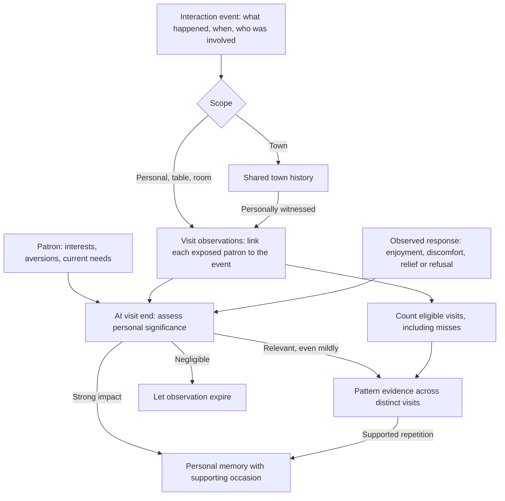

# Travelling Inn — Mood and Memory: Overview

24 November 2026 · Built from [design-session-journal-mood-memory.md](design-session-journal-mood-memory.md)

Read from the top down. Each part says the same thing one level deeper: the idea, then the concepts, then how it plays, then how it works, then worked examples. Stop wherever you have enough.

Nothing here is built. Most of it is still a proposal; the [Status](#7-status) section lists what is decided.

## Summary

The inn is about getting to know people well enough to care for them, and giving them room to care for the keeper in return. **Mood** is how someone is doing today; it decides how a gesture lands. **Memory** decides whether that gesture stays with them. A guest keeps only the few occasions that meant something to them, given who they are. Repeated occasions turn into expectations, habits and small rituals; public milestones become things the whole town can talk about. The **keeper** has a mood too: it colours what they cook without making it worse, and shapes the morning hand of taproom cards. Time and the limited hand give care a cost. In return, regulars who know the keeper well may one day offer care back.

## Index

1. [The idea](#1-the-idea)
2. [Core concepts](#2-core-concepts)
3. [How it plays](#3-how-it-plays)
4. [How it works](#4-how-it-works)
   - 4.1 [Noticing](#41-noticing)
   - 4.2 [Events and their reach](#42-events-and-their-reach)
   - 4.3 [Appraisal: what matters to this guest](#43-appraisal-what-matters-to-this-guest)
   - 4.4 [Forming a memory](#44-forming-a-memory)
   - 4.5 [Repetition: routine, expectation, habit](#45-repetition-routine-expectation-habit)
   - 4.6 [Bringing a memory up](#46-bringing-a-memory-up)
   - 4.7 [Town history](#47-town-history)
   - 4.8 [The keeper's mood and the morning hand](#48-the-keepers-mood-and-the-morning-hand)
5. [Worked examples](#5-worked-examples)
6. [Feasibility and first tests](#6-feasibility-and-first-tests)
7. [Status](#7-status)

---

## 1. The idea

### Care has a cost, and it should be noticed
The keeper has limited time and a limited hand of gestures. Spending a moment with one guest means giving them a piece of the day. For that choice to carry weight, the guest has to notice it, in their own way.

### Two pillars: reactivity and reciprocity
Reactivity: the same gesture lands differently with a particular person on a particular day. Reciprocity: over time, a guest comes to know the keeper well enough to offer something back. The reward is seeing that a relationship has changed, not repayment for each kindness.

### Why mood, why memory
Mood gives the keeper a reason to pay attention today, even to someone they've known for years. Memory lets an evening matter after it ends.

## 2. Core concepts

### Baseline and mood
Everyone has a long emotional baseline, and a mood that moves through it like weather and drifts back. A sorrowful person can have a joyful afternoon. (Spec 3 calls the baseline the *season*; the journal says *climate*. See [Status](#7-status).)

### Qualities
Things in the inn carry qualities other actors can notice: stew is *warm* and *hearty*, a tune is *lively*, a room is crowded or clean. Which qualities matter depends on who's noticing and what they need.

### Interaction events
Something happens: an offer, a quarrel, a performance, a first house beer. The event decides whom it reaches. Each guest decides how strongly it lands and whether it's good or bad for them.

### Personal memory
A guest keeps a few meaningful occasions, with true details. Not a log of everything.

### Town knowledge
Public milestones and patterns anyone in town can mention. Only someone who was there can claim to remember it.

### Keeper mood
Colours the character of what the keeper makes, never its quality, and shapes the morning hand of taproom cards.

## 3. How it plays

### Reading guests
Guest mood shows the keeper how someone is doing, and the effect of the keeper's own actions and of the room: warmth, crowding, cleanliness, music, food, other people.

### Gestures land differently
The same tea can warm one guest and embarrass another, or both at once. A guest can leave as sad as they came and still remember the kindness.

### Guests remember, rarely and truthfully
Now and then a regular mentions something: "Remember that week he kept making that stew?" Remarks are rare, earned, never repeated, and only about things that guest actually lived through. Silence is a fine outcome.

### Repetition becomes something
A cup set down often enough becomes an expectation: Hedda puts her hand where the mug usually lands. That can grow into a habit, an inside joke, a ritual between keeper and guest.

### The town talks about the inn
Milestones (the first house beer, the stable opening) and patterns (the menu changes every week) become topics. People can agree on a fact and disagree on whether they like it.

### The keeper's day
Morning mood shapes the hand of taproom cards; the player picks a few to carry. A wistful day can give a familiar pie a character a regular comes to cherish. Lulls give time to read, smoke a pipe or play darts, which can shift the keeper's mood.

### The inn cares back
After several busy days, arrivals may ease while a close regular stays on and pours a second cup. The player can sit down or carry on. Some encounters may become a **dialogue** that pauses service.

## 4. How it works

### 4.1 Noticing

#### Three sources
Keeper to guest (an offer, a card), the prepared room (fire, music, cleanliness, snacks), and guest to guest (a quarrel, a cheat at darts, a shared joke).

#### Noticing at natural moments
Guests take stock when something meaningful happens: settling into a seat, finishing food or drink, an interaction. Walking in and leaving are chances to notice cleanliness. Entering earshot is a chance to notice the gramophone.

#### No scanning every tick
Room conditions are stored once; guests consult them when relevant. Sitting wet by a lit fire schedules a drying time; leaving or losing the fire interrupts it. A new tune updates the room once, and only listeners it matters to react.

#### Staggered attention
Each guest checks on their own offset, samples a few cues from room, table and activity, and needs or mood colour what stands out. A check can end with no reaction. For music, a listener gets one roll per listening session; stepping in and out of range doesn't give a fresh one. Interval and selection rule: open.

### 4.2 Events and their reach

#### `interactionEvent`
The working name. It records what happened, when, and who was involved.

#### Scope
Personal (the recipient), table, room, or town. An offer reaches one guest; an argument a table; a performance the room; a public milestone the town.

#### Reach, strength, direction, repetition
Reach belongs to the event. How strongly it lands and in which direction belong to each guest. Repetition counts comparable occasions for that guest. One shared performance can leave very different personal memories.

#### Who actually knows what
Someone who heard an argument can remember the row; only someone who saw the cheating can remember who cheated. Being in the room isn't the same as noticing. Companions count when they change what the guest experienced.

### 4.3 Appraisal: what matters to this guest

#### Candidate traits
Preferred company (solitude to company), bustle (stillness to bustle), autonomy (how much being consulted matters), novelty (familiar to surprising), and possibly privacy and disgust sensitivity, kept only if they change play. None are assigned to real guests yet.

#### Weighted concerns
An event exposes the qualities a guest actually perceived and how strongly. For each concern that matches, multiply the cue's strength by the guest's signed sensitivity. Compare that with what actually happened to them (relief, a taste, a need met). Keep the strongest reasons, with their signs.

#### Mixed stays mixed
Direction and strength are kept apart, so grateful-and-embarrassed survives. A single good/bad score would lose it.

#### Evidence must come from the interaction
"Tea served" can't explain a reaction. The event has to carry the cues: was the guest singled out, did they have a choice, have they had this before.

### 4.4 Forming a memory

#### Selective, not a log
Observations are kept for the visit, then assessed at its end. Most expire.

#### Two ways in
A strong occasion becomes a memory at once. A mild but relevant one adds evidence toward a pattern across distinct visits; enough of it becomes a memory too.

#### Count the misses
Track eligible visits, not only matches: three Thursdays with music out of three is a pattern; a fourth Thursday without music makes it three of four.

#### What a memory holds
Whose memory, the event (what, who started it, when), the concrete details (item, the need beforehand, accepted or declined), and what the guest experienced (taste, relief, mood before and after if known). An offer and its refusal are both true; the taste of tea never drunk is not.

#### The flow

#### The trade-off
A full log could answer questions nobody thought to ask, but grows and costs processing. A visit buffer with selected episodes and small counters stays bounded but forgets connections it didn't track. The journal leans to the second.

### 4.5 Repetition: routine, expectation, habit

#### Routine or deepening
Compare a recurrence with what the guest already expects. A familiar occurrence reinforces the pattern without a new episode. It deepens the memory when its consequences still matter, the circumstances give it new meaning, or an expectation is broken. Surprise alone isn't enough.

#### Remembered runs
The first great stew stands out on Monday; by Friday it's expected; when it leaves the menu, what survives is a stretch of time. A later serving can extend the run (count and time span) without becoming its own anecdote.

#### What strengthening and fading mean
Strengthening carries a memory forward until it becomes something else: an expectation, a habit, an inside joke, a ritual. Fading is either familiarity (individual servings blur, the expectation stays) or forgetting (it no longer shapes anything). Rules: open.

### 4.6 Bringing a memory up

#### At the moment of talking
Use the present cue and listener to find relevant memories, account for recent mentions, then pick one or stay silent. Runs are grouped as they happen, so nothing is rebuilt at talk time.

#### Earned and retired
Familiarity and mood govern when a guest speaks. A told anecdote is retired, paraphrases included. A guest who never visited in winter can't reminisce about winter at the inn. A quiet guest may keep a memory without voicing it.

#### First test
When the keeper serves a familiar guest, a fitting line appears at the table and service goes on. Try that alone, before any reward.

### 4.7 Town history

#### Milestones, kept once
A public milestone is stored once with its in-game date: the inn opening in summer, the stable opening six months ago. Anyone can refer to it; first-person claims need the guest to have been there.

#### The first house beer
For "the inn serves its own beer", the proposed trigger is the first actual serve, not buying the licence. One event gives the town a topic and the recipient a chance at a personal memory. No news-spreading simulation needed.

#### Patterns across days
"The menu changes every week" or "the menu never changes" comes from the bills of fare actually served, ignoring draft edits.

#### Known for versus regarded
What the inn is known for is separate from how well it's thought of. Different guests value the same fact differently.

### 4.8 The keeper's mood and the morning hand

#### Any direction
Wistfulness, homesickness, sadness and joy all belong in this inn. Shifts can be sideways as well as up or down. Serving, a delight, gifts, comments, a story, a quiet moment can all move it.

#### Character, not quality
Mood shifts what the keeper brings to a pie or a brew without penalising it. A batch can be remembered fondly and worth recapturing. Open: how to show that imprint without it reading as a ranking.

#### The hand you were dealt
Each morning, mood shapes the taproom hand; the player chooses a few to carry and spend (a towel offered, remembering past summers, humming a childhood tune). People don't always have the right words or time for everyone.

#### Lulls
Reading, a pipe, darts alone or with a guest can shift the keeper's mood and, if shared, someone else's. Open: does a lull restore a spent use (finding capacity again) or give a fresh draw (a new thought the afternoon made possible)?

#### Care coming back
A regular may read the keeper's mood and offer a fitting gift or gesture, or pour their own tea. Open: does receiving care shift the keeper's mood, open a choice, or simply mean something?

## 5. Worked examples

### Hedda and *Offer Unasked*
Hedda, the miller's widow, says little, loves rain and grey weather, dislikes storms, likes warmth and homely drinks. She comes in shivering; the keeper plays *Offer Unasked* and brings hot tea before she asks. The keeper's action supplies who offered what and whether it was asked for. Hedda supplies the rest: her need, whether she drank, whether it warmed her, how it landed. This is the agreed starting case for memory.

### A candidate calculation
Give each guest a signed preference for unsolicited help, −2 to +2 (Hedda's is unknown). Rate relief from the offer 0–2 from her need and what she drank; a refusal gives zero. Salience is the larger of the two magnitudes: 2 keeps an episode, 1 adds at most one trace per comparable visit, 0 drops it. Keep reaction and relief signed and separate. Illustrative numbers only; the journal later found this too narrow and generalised it into the weighted concerns of [4.3](#43-appraisal-what-matters-to-this-guest).

### Repeated offers
Repeating the card shouldn't make a new memory each time. Repeats in one sitting differ from care recurring across visits. Open: could repeatedly offering something Hedda hates lead her to refuse?

### The tea: one offer, two guests
Invented profiles: Hedda likes a little company, tires of bustle, values choosing, prefers the familiar; Tobin seeks company and bustle, welcomes others taking the lead, likes novelty. Both come in cold. The keeper leaves a pot of a new blend between them and goes back to the bar. Tobin pours first; Hedda takes half a cup, later the rest. The keeper took the initiative but left her the choice, so autonomy isn't offended; the new blend was a small hesitation for her and a draw for Tobin. Company and bustle didn't change, so those traits have no say. Hedda may remember the pot left with her on a cold night.

### The darts: one invitation, one audience
Another evening: "Trying doubles tonight. Fancy partnering Tobin?" Hedda accepts one round; Tobin is up at once. Then a spoon rings on a mug and the room turns to watch. Two events: a private invitation with a choice, and a room-wide rise in bustle with attention on the players. Hedda may remember enjoying the round and disliking the audience; Tobin, a new game before a cheering room. A silent but watching room would test privacy on its own.

### The Thursday test
Three Thursday visits with music heard and enjoyed, out of three, support a pattern; a fourth Thursday without music makes it three of four. Count visits, not songs.

### The stew
See [remembered runs](#45-repetition-routine-expectation-habit): stands out, becomes expected, leaves the menu, survives as "that week he kept making that stew".

## 6. Feasibility and first tests

### Feasible as event-driven appraisal
Work scales with affected guests per event times a few relevant traits. Existing tastes, tags and needs are inputs. Social cues (singled out, had a choice, had it before) must come from the interaction. Novelty needs a little per-guest history. Not benchmarked or implemented.

### The real cost
Authoring interactions that are distinguishable, and tuning retention so guests neither hoard nor miss what matters.

### How to test
Start with two event families (offers and music) and two contexts (the need at the offer, the weekday of the visit). Run identical offers or invitations with one cue changed at a time, inspect each guest's reason, and repeat to check deduplication. Compare different guests on the same visits. For mood itself, one value plus what last moved it.

## 7. Status

### Decided
- Selective memory formed from scoped events and guest traits, with no permanent event log per guest.
- An event's reach (recipient, table, room, town) is separate from who holds the memory (one guest's experience, or a shared town fact).
- Town knowledge and personal recollection coexist in conversation.
- Keeper mood shifts the character of food and activities, never their quality.
- The keeper's morning mood shapes the hand of taproom cards.
- Repeating a card doesn't make a new memory each time.
- Starting case: Hedda and *Offer Unasked*.

### Proposed, to test
Noticing at natural moments, stored room conditions, staggered checks; the candidate traits; weighted-concern appraisal; strong-or-accumulated memory forming; routine-versus-deepening; retired anecdotes; first actual house-beer serve as the milestone; pacing a lull for reciprocity.

### Open
How memories strengthen and fade; when guests speak; which encounters pause for a dialogue; restore versus fresh draw; showing the keeper's imprint without ranking; refusal after repeated dislikes; check intervals and weights.

### Not yet covered
Mood itself (needs, the value and its pull to baseline, what moves it); contagion through dominant guests; named keeper moods (Spec 3's wistful, buoyant, flustered) versus free shifts; how traits relate to tastes and schemas; baseline naming, *climate* versus Spec 3's *season*.

### On the board
#101 Mood (epic). Shows in #76 overlay and #90 Innsight. Drives #102 taproom card game. Fed by #35 music, #103 activities, #100 weather, #45/#69 room feel and reputation. Comes out in #55 walkouts and #92 Delights too easy. Also #56 staff, #40 prologue.
